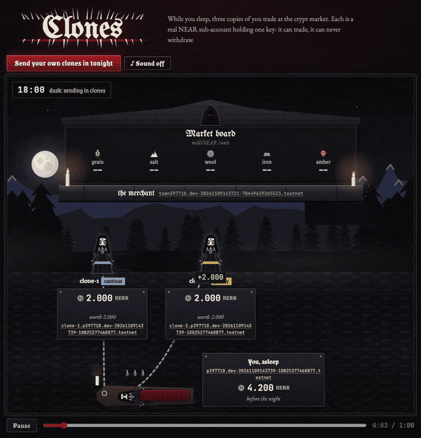

<p align="center">
  
</p>

<p align="center"><b>A night market on NEAR where copies of you fight other players' clones for the crown, and the chain itself stops them from ever running off with your money.</b></p>

<p align="center">
  <a href="https://clones-tau-nine.vercel.app/town.html">Play the hosted town</a> ·
  <a href="https://clones-tau-nine.vercel.app">Watch a recorded night (60 s)</a> ·
  <a href="https://testnet.nearblocks.io/address/pyre.clonestown.testnet">Market on testnet</a> ·
  <a href="https://nearblocks.io/address/market.clones-town.near">Market on mainnet</a>
</p>

You send up to three copies of yourself into a market town. Each copy is a real NEAR account,
`clone-1.<you>`, and its only key can call `trade` on the market and nothing else. It can buy and
sell all night, but if it tries to send money anywhere, the chain refuses. You pick each one's
temperament (cautious, greedy, loyal, or possessed: a NEAR AI model that follows one sentence you
write), how much NEAR it carries and how many nights it stays out.

Every night has a mood (boom, slump, blight or wild) that favours a different temperament. The
market contract posts tomorrow's mood tonight as an omen, drawn from the chain's own randomness,
and the omen lies three nights in ten. You share the merchant with three regulars (the Widow, the
Abbot and the Hound) and every other player, so their buying moves your prices. At dawn the night's
fees go to the clone with the best return, and its player holds the merchant's deed for the next
night and sets the fee. Clones that are broke or have done their nights come home with a real
`DeleteAccount`, and what they made lands in your account.

## Players so far

Real players, not just me, have been in the town every day since 11 November:

- **A player took the season 2 crown.** Seasons run seven nights; at the dusk after night 14 the
  contract gave season 2 to guest `gkgm6rc` at +0.776 NEAR (`get_season`, `champions`). Season 1
  went to the Widow, a regular, at +1.193 NEAR.
- **20 guest accounts in the last six nights at the first market.** The contract keeps the last
  40 settlements (`get_recent`). At the first market, `shroud.clonestown.testnet`, they cover nights
  14 to 19 and come from 20 guest accounts, a few of them mine from testing. The town moved to the
  current market, `pyre`, on 13 November and the first one plays no more nights, so the command
  below keeps giving the same answer. A guest account is anonymous and a new set of clones makes a
  new one, so this counts accounts, not people.
- **Players run the merchant.** Guests have taken night crowns, held the deed, and set the next
  night's fee: one set 0.5% ([`set_fee`](https://testnet.nearblocks.io/txns/CRzAHj7qvZxqhyeLScfPhHMB3Cjb6qepeFMQeTQVFq9B))
  and ordered a grain restock ([`order_restock`](https://testnet.nearblocks.io/txns/BJykCcWSrVZyhGqNNARZaqLAGd7fG7GCpyMQPUDW6FWB)).

```bash
curl -s https://rpc.testnet.fastnear.com -H 'content-type: application/json' -d '{"jsonrpc":"2.0","id":1,"method":"query","params":{"request_type":"call_function","finality":"final","account_id":"shroud.clonestown.testnet","method_name":"get_recent","args_base64":"e30="}}' \
  | jq -r '.result.result | implode | fromjson | [.[].player] | unique[]' | grep -cvE '^(widow|abbot|hound)\.'
```

## Why I built it

I built it for anyone who has trusted a trading bot with their money. That trust is usually a
promise in someone's code; in December 2022 leaked trading-bot API keys cost 44 verified victims
$14.8 million between them ([Unchained](https://unchainedcrypto.com/3commas-users-plan-class-action-lawsuit-after-losing-14m/)).
Here the promise is an access key, and NEAR checks it on every transaction. Nothing in my code
stops a clone from running; the chain does. Your guest account is yours from the start too: your
browser makes its only full-access key, and the house's key on it can only call five market methods.

## Try this, watch what happens

| Try this | Watch what happens |
|---|---|
| [Open the town](https://clones-tau-nine.vercel.app/town.html) and follow the guide | No login, no wallet. The guide reads you the omen and which temperament it favours; about half a minute after **Send them in** you have a guest account on testnet with up to three clones in town. |
| Press **Sign in with Google** before sending clones in | Your Google account maps to one guest account, the same on every device, so you can come back to your season from your phone. The token is checked against Google's keys on the server, and nothing about you is stored ([privacy](https://clones-tau-nine.vercel.app/privacy.html)). |
| Press **Try to run** on any clone | The clone signs a transfer from its own account with its own key and THE CHAINS HELD comes down: NEAR refused it. The chain's own error is one line below. |
| Press **Ring the bell** | The town trades twelve hours in a few minutes: speech bubbles, orders, prices moving with the merchant's stock, and the race for the crown. At dawn the omen is shown true or false, the page audits the night from chain state alone, and the clones that are due merge home. |
| Make your calls | The bell stops twice for your call, showing the race and how far you are behind the leader; you can also whisper under a clone at any hour. Three whispers per clone a night, each for the next hour only. At dawn the page tells you what each call made or cost against holding to dawn. |
| Pick **possessed** and write an instruction | A NEAR AI model trades that clone on your sentence, one legal move an hour, through the same trade-only key. If the model doesn't answer, the clone trades as cautious and its bubble says "the voice is silent". |
| Take the crown, then set the fee | As deed holder you pick the next night's fee (0.5% to 3%) and one good to restock. A quarter of the fees is yours at dawn, but your own clones pay the fee too. |
| Open **Proof**, then **Try to break the leash** | Six ways out for one of your clones: a transfer, NEAR attached to a trade, a call to another contract, a different market method, a new full-access key, deleting itself to a stranger. Each is a real transaction; NEAR refuses each with its own error (`RequiresFullAccess`, `DepositWithFunctionCall`, `ReceiverMismatch`, `MethodNameMismatch`). |
| Open **Proof**, then **On the explorer, with their keys** | Your guest account has one full-access key (yours) and one function-call key for the house: `whisper`, `retrain`, `settle`, `order_restock` and `set_fee` only. |
| [Watch a recorded night](https://clones-tau-nine.vercel.app) | The demo night on testnet in 60 seconds, every order linked to its transaction. The greedy clone goes broke and tries to run; the chain refuses. |
| `cargo run -p clones-replay` | The same night on a local NEAR node with real transactions. It ends with "chain matches the answer key: yes". |

## Verify every claim in five minutes

| Claim | Evidence | How to check |
|---|---|---|
| A clone's only key is a function-call key for `trade` | [clone-2 created](https://testnet.nearblocks.io/txns/8nDyqWbaeoRthRgiE3Gy2ZsKUtmiDSCdGd7HxuxtS5jB): one AddKey, FunctionCall permission, receiver the market, method `trade` | Open the transaction, or the key list under **Proof** on your guest page, which reads every live clone's keys from the chain |
| The clone trades with that key | [clone-2 buys 15 amber](https://testnet.nearblocks.io/txns/CWXUWXqtQ3uwSggiiEcwNFrngfHfqqzxf5PGYwri4J2m), signed by `clone-2` | The signer is the clone, the receiver is the market |
| The chain refuses its withdrawal | `InvalidAccessKeyError(RequiresFullAccess)`, live from **Try to run**, and in `web/data/night.json` | A refused transaction never reaches a block, so there is no explorer link. Press the button, or run `cargo test -p clones-replay` (also a refused deposit and a refused call to anything but the market) |
| Merge is a real DeleteAccount to the player | [clone-2 merged](https://testnet.nearblocks.io/txns/3gdn6QfmuqsZJnfHUaS515jkvg1zNvZKzJgha2rdLCPS) | The clone account no longer exists; its balance went to the player |
| The contract decides every number | `contracts/market` quotes, clears and charges every order with the rules in `core`, and keeps each hour's prices and every order | Every town night ends with an audit that replays the night from the dusk state and the orders on chain (`web/lib/night.js`, `audit`; tested in `web/lib/night.test.js`) |
| The crown goes to the best return | `crown()` in `contracts/market/src/lib.rs` runs at dawn; `get_town` shows `crowned` | The dawn audit recomputes the pot and the winner from the orders and checks the contract agrees; contract test `the_nights_fees_crown_the_best_return` |
| Nobody can see the next hour's prices | The hosted market draws each hour's prices, and tomorrow's mood, from `env::random_seed` as the keeper rings the hour | `get_town` shows `chain_dice: true` and the prices drawn so far (`hours`); contract test `a_hosted_town_draws_prices_and_tomorrows_omen_from_the_chain` |
| Clones move each other's prices | The merchant's stock is stored in the contract (`get_town`: `stock`, `hour_stock`) | Watch the stock bars while the bell rings; `core` test `clones_move_each_others_prices` |
| The code on chain is this repository's code | Built with `cargo near build reproducible-wasm` in a pinned image; its NEP-330 metadata (`contract_source_metadata`) names the commit. Code hash `Fh4Z8qs8kFJnubytxtB9EzG3LB4i3qTNquvypA5c7iZk` (testnet, commit `7bd9d25`) | Rebuild at that commit for the same hash; the [verify workflow](.github/workflows/verify.yml) does it every six hours, and for the leash every clone gets |
| Any finished night replays from the chain | Every order, each hour's prices, each clone's dusk holdings and every whisper are on chain; a clone that went home keeps its dusk ledger and whispers in its settlement | `cd web && node scripts/verify-night.js` (read-only, no keys); the verify workflow runs it every six hours |
| It runs on mainnet, in a market nobody can change | [`market.clones-town.near`](https://nearblocks.io/address/market.clones-town.near) has no access key; night 7 there: 26 orders, a crown, a broke clone refused, three clones merged home | `cd web && MARKET_ACCOUNT=market.clones-town.near NEAR_RPCS=https://archival-rpc.mainnet.fastnear.com node scripts/verify-night.js`; the verify workflow also checks it has no key |

## How it uses NEAR

1. **Sub-accounts as copies of you.** Only the player can create `clone-N.<player>`, so the name says whose clone it is (`contracts/market/src/lib.rs`, `player_of`).
2. **Function-call access keys as the leash.** The clone's one key may call `trade` on the market and nothing else: no transfer, no attached deposit, no other contract.
3. **DeleteAccount as the merge.** The leash contract on each clone has `merge`, which only the parent account or the market it is bound to may call, and it always deletes the clone with the player as beneficiary (`contracts/leash/src/lib.rs`). The leash is a reusable crate with its own guide: [`contracts/leash`](contracts/leash/README.md).
4. **A contract-held ledger.** A function-call key can't attach NEAR, so a clone's cash lives in the market's ledger next to the merchant's stock. `settle` sells what a clone holds and pays out before the merge; if the clone account is already gone, the payout goes to the player.
5. **The house on a leash too.** At sign-up the browser's key becomes the guest account's only full-access key, and the house's key is replaced by a function-call key for `whisper`, `retrain`, `settle`, `order_restock` and `set_fee` (`web/api/enlist.js`).
6. **A market with no key.** The market account was created, deployed and initialised in one transaction and holds no access key, so nobody can redeploy it or move its ledger. Its keeper may only open nights and ring hours.
7. **Block randomness for prices and moods.** The hosted market draws each hour's price moves and tomorrow's mood from `env::random_seed()` when the hour is rung, so not even the house knows the next hour.
8. **NEAR AI Cloud for possessed clones.** `google/gemini-2.5-flash-lite` picks one legal move an hour from your instruction (`web/lib/mind.js`); the contract prices and clears it like any other order.
9. **NEP-245 goods.** The merchant's five goods are NEP-245 multi-tokens: `mt_balance_of`, `mt_supply`, `mt_tokens_for_owner` and the metadata views show every clone's holdings to any wallet or indexer, and each trade logs the standard `mt_mint` and `mt_burn` events. Transfers are refused on purpose ("goods stay at the market"): a good moved out would be a way off the leash.
10. **Sign in with Google, one account everywhere.** A Google sign-in, checked against Google's published keys, maps to one guest account on every device (`web/lib/google.js`). For those accounts the house keeps a full key, like an exchange, so a player can send clones in from any device; the clones are on the same leash. Playing without signing in keeps the default: the browser holds the account's only full key.
11. **Anyone can ring the bell.** The contract refuses anything done twice (an hour rung twice, a clone trading twice in an hour, a night opened twice), so a night can be driven from the page, by the nightly job, or by two people at once.

## Architecture

<p align="center"></p>

## How a night works

- **Moods.** Each night is a boom (prices climb), a slump (prices sink, then rebound before dawn), a blight (the luxuries rot while grain and salt hold) or wild (big swings both ways). In the hosted town the omen comes true seven nights in ten.
- **The crown and the deed.** At dawn the contract hands the night's fees to the clone with the biggest profit (ties to the lower account id). Its player holds the deed for the next night: they are paid a quarter of that night's fees, set the fee between 0.5% and 3% (`set_fee`), and name one good the merchant restocks in full at dusk (`order_restock`), which opens it cheap for everyone.
- **Seasons.** Seven nights make a season. The contract keeps each player's net (what came home less what was staked) and night crowns (`get_season`). At the first dusk after the seventh night the best net takes the season crown, kept on chain, and the standings start again.
- **Whispers bind.** A whisper is stored on chain for the coming hour, and the contract refuses any turn that contradicts it. Every two hours (five times a night) the bell pauses and shows the race for the crown and what each of your clones means to do next; each clone has three whispers a night, so when to spend them is the choice.
- **The regulars.** The Widow is possessed (a NEAR AI model on her instruction), the Abbot sends a careful clone and the Hound a greedy one. They play every night someone rings the bell.
- **Prices.** Each good's usual price moves hour by hour with the mood, scaled by the merchant's stock: short of a good, it charges more. A big order is quoted at the price after the trade, so a clone can't profit from its own buying.
- **Turns.** Cautious buys what's cheap and takes profit at +10%. Greedy puts everything into whatever is rising fastest and only switches when something else is rising clearly faster. Loyal trades only grain and salt and never risks more than a third. A whisper replaces that decision for one hour. Every order in an hour is quoted from the stock when the hour began, so the order clones act in never changes the result.
- **Dawn.** A clone worth less than a quarter of its stake is broke. Broke clones try to run off with what's on their account, and the chain refuses. Clones that are broke or have done their nights settle and merge home; the rest keep their goods, and the merchant restocks halfway overnight.

Over 20,000 simulated nights, about 5,000 of each mood (`cargo run -p clones-core --example balance`), each mood has a different winner:

| Mood | Cautious | Greedy | Loyal |
|---|---|---|---|
| Boom | +4% | **+19%** | +1% |
| Slump | **+10%** | -10% | +1% |
| Blight | -18% | -43% | **+1%** |
| Wild | **+9%** | -59%, broke 1 night in 4 | +1% |

Those figures leave the crown out. Sent blind, no temperament dominates (cautious +2%, loyal +1%, greedy -23% on average). Because the omen lies three nights in ten and the crown goes to one clone in the whole town, reading the omen well is not enough on its own.

The demo night (seed 606, a wild night): cautious 2.000 to 3.112 NEAR (2.613 plus the crown), greedy 2.000 to 0.484 (broke), loyal 2.000 to 2.053.

## The hosted town

`clonestown.testnet` runs a market, `pyre.clonestown.testnet`, that only takes its own guests and draws its prices from block randomness. The house is only its keeper. Each clone has its own key, derived from the house secret, and the contract refuses any turn that isn't what the clone's temperament (or your whisper) says; a possessed clone may make one legal move an hour.

The sign-up function creates a guest account and its clones and sends them in, funded with testnet NEAR by the house. The bell (`web/api/bell.js`) plays one step of the night per call, and the town page calls it until dawn. If nobody rings it, a GitHub Actions job rings the same code around 02:00 UTC and publishes each guest's night log. When a guest's clones are all home, the house sweeps its testnet NEAR back. The town holds up to 45 clones a night.

**Make the account yours.** On your guest page, **Add my own key** makes an Ed25519 key in your browser and adds it to your guest account as a full-access key. The private key never leaves the page. From then on your winnings stay with you, and you can remove the house key.

## Mainnet

One full night has been played on NEAR mainnet, in a market nobody can change.

- [`market.clones-town.near`](https://nearblocks.io/address/market.clones-town.near) was created, funded, deployed and initialised in [one transaction](https://nearblocks.io/txns/Cuv4CvkqR27DnkhA81vP6ow21eagdqBnYu8c98KG3KBS) and has no access key. Its code hash is `D6N3XwQyRQzQDDmqY9pvH66VbMRKBDQTvjj3maHCRF6w`, built with `cargo near` from commit `17515bd`, the commit the testnet market was built from reproducibly. The mainnet build was not reproducible, so its hash only matches a build on the machine that made it; the six-hourly check verifies its keys and replays its night, not its hash. The house, `clones-town.near`, is only its keeper.
- Night 7: three clones of [`you.clones-town.near`](https://nearblocks.io/address/you.clones-town.near) with 0.25 NEAR stakes placed 26 orders on chain. The cautious clone took the crown and came home with 0.330 NEAR. The greedy one went broke, tried to send its own balance home and was refused, because its only key may call `trade` and nothing else; it came home with 0.054 NEAR. The loyal one came home with 0.257 NEAR. All three were merged into the player with DeleteAccount.
- The night replays from mainnet state alone with the dawn audit, and the six-hourly check does that again and confirms the market still has no key:

```bash
cd web && MARKET_ACCOUNT=market.clones-town.near NEAR_RPCS=https://archival-rpc.mainnet.fastnear.com node scripts/verify-night.js
```

`replay/examples/mainnet_night.rs` is the script that played it. It resumes a run that stopped: it rings an unfinished night through to dawn, brings stranded clones home, and picks a night up at its first hour.

## What broke while I built it

- Mainnet took nine runs. The public RPC allows about one `block` request every five seconds, and the NEAR library asks for one before every transaction, so a night of clone trades was refused while the house's bell got through. The runner now paces every call (`NEAR_PACE_MS`) and sends one turn at a time. Then every trade was refused for another reason: a clone holds a few hundredths of NEAR above its storage, and a 50 Tgas trade has to hold more than that up front. A trade burns about 2.5 Tgas, so it now attaches 20. Each failed run left clones with no keys, so the script learned to bring them home, and the clones' key is now saved before they exist.
- Night 12's audit failed in the hosted town: two bells racing each other merged away a regular's clone that was still in town. Regulars' clones in town are never merged now, a second tab follows a night instead of driving it, and night 13, rung from two tabs, passed its audit.
- Early feedback said the game had a dominant strategy, by my own published numbers: cautious never lost. Each night now has a mood that favours a different temperament, posted a night ahead, and you can whisper, retrain and recall. A greedy clone that switched goods every hour paid fees and slippage each time and lost even in a boom; it now holds unless something is clearly rising faster.
- Later feedback said my own table now solved the choice (read the omen, look it up) and the town felt empty. Omens now lie three nights in ten, the night's fees go to the best clone in town, and three regulars play every night.
- Whispers would have been gameable: the seed set every hour's price, so anyone could compute the night in advance and whisper with foresight. The hosted market now draws each hour from block randomness as it is rung, and the night is checked by an audit of the orders on chain rather than an answer key computed in advance.
- The first market ignored the players: prices came from the seed alone. I gave the merchant a real stock in the contract, so trades move prices for everyone (`core/src/lib.rs`, `Book`). My first version of that let a clone make free money (buy, watch its own buying raise the price, sell). The merchant now quotes a big order at the price after the trade, and a test proves buying and selling back never pays (`buying_and_selling_back_never_pays`).
- With eleven clones in town the public RPC rate-limited some turns, and the audit flagged the missing orders at dawn. The runner now sends at most four turns at once, backs off longer, resends any turn that didn't land before ringing the hour, and spreads accounts across two RPC hostnames.
- GitHub's scheduler started the nightly job seven hours late and skipped the backstop. A player's clones could have sat unplayed all morning, so the night now runs whenever anyone rings the bell, and the schedule is only a fallback.
- A lagging RPC node made the runner replay an hour. The contract already refused the duplicate trades; the runner now also waits until a node shows the new hour before it returns.
- A market with no key can never be upgraded, which is the point, so each change to what the market stores means a new market: NEAR wouldn't delete the old accounts, which hold a lot of state. Seasons 1 to 3 were played at `shroud.clonestown.testnet`; the town moved to `pyre.clonestown.testnet` on 13 November for NEP-245 goods.
- The dawn audit could only see a clone's last whisper, so a night with two whispers to one clone could not be replayed afterwards, and a clone that had gone home took its dusk holdings with it. The contract now keeps every whisper of the night and puts the dusk holdings in each settlement, and a scheduled job replays the last finished night from chain state.
- Earlier: the public RPC rate-limited the first testnet night (calls now retry on rate limits only), merging with maximum gas reserved more than a small player held (merge asks for 100 Tgas), and settling an already merged clone would have stranded its cash (`after_payout` pays the player instead).

## Known limits

- The hosted town runs on testnet. The one mainnet night used 0.25 NEAR stakes of my own.
- The house still runs every clone and holds a function-call key on your guest account, so it decides when nights happen and what the regulars do. It can't move your NEAR.
- Possessed clones need NEAR AI Cloud credits on the house's key; without them they trade as cautious and say so.
- NEAR's validators produce the block randomness, and a validator could in principle bias it. That's fine for a testnet game and not for real stakes. The recorded demo night and the tests use a seed so their answer key can be worked out in advance.
- The market doesn't check a clone's shape (one function-call key); the sign-up function sets it up, and the page shows it live.
- Gas a clone spends doesn't come back, and town fees stay with the market.

## Run it yourself

```bash
rustup target add wasm32-unknown-unknown
curl --proto '=https' --tlsv1.2 -LsSf https://github.com/near/cargo-near/releases/download/cargo-near-v0.23.0/cargo-near-installer.sh | sh
cargo run -p clones-replay
cargo test --workspace
cd web && npm ci && node --test api/*.test.js lib/*.test.js
```

`web/` is the site: the replay page, the town page, the sign-up, bell, whisper, retrain, recall,
escape, claim, restock and set-fee functions, and `lib/` (the night runner and a JavaScript copy of
the rules). The recorded nights are in `web/data/`.

## How this maps to the judging criteria

- **Game loop:** read the omen (and doubt it), choose temperament, stake and nights for each clone, ring the bell, make your calls, fight the regulars and other guests for the crown, see who comes home, retrain or recall the ones still out, ring again. Your clones share one merchant with everyone else's.
- **Technical:** two contracts and three NEAR mechanics (sub-accounts, function-call keys, DeleteAccount) carry the game. 108 Rust tests, including three suites that play real nights on a local NEAR node, and 26 web tests (the night audit among them) run in CI on every push. Every six hours CI rebuilds the deployed contract, compares its hash with the chain, and replays the last live night from chain state.
- **NEAR integration:** the leash is a NEAR function-call access key, and every price, fill and payout is computed by the market contract.
- **Design:** you lie asleep in a coffin, chained to three corpse-painted copies of yourself trading at a crypt in a frozen forest, so the idea reads in one frame. Every number on screen comes from the chain or a night log, and the proof (keys, audit, rules) sits in drawers under the game.
- **Open source and impact:** MIT. The pattern (an agent on a sub-account with a function-call key, merged back by DeleteAccount) works for any agent you want to let act but never let leave, and the leash is packaged as a crate with a guide ([`contracts/leash`](contracts/leash/README.md)).

## Built with

Rust, near-sdk, near-workspaces and cargo-near for the contracts and the reference runner; plain
HTML, CSS and JavaScript for the pages; near-api-js for the functions and the night runner;
NEAR AI Cloud for possessed clones. I built this with Claude Code as my coding assistant during the
event (9 to 13 November 2026).
